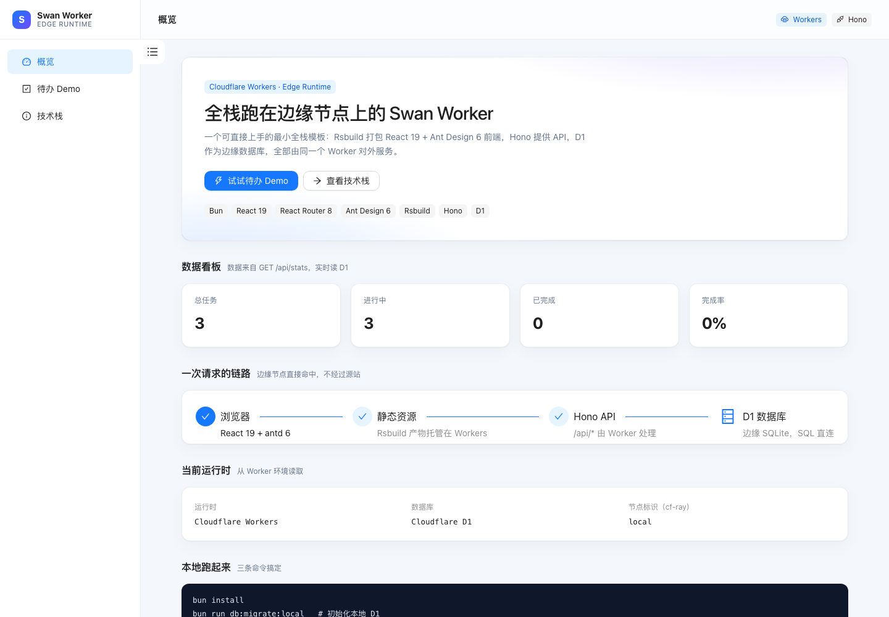
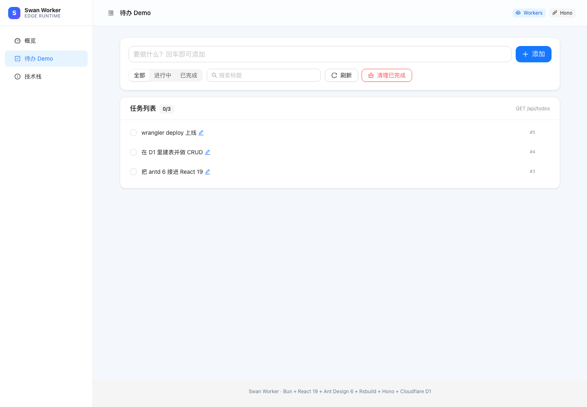
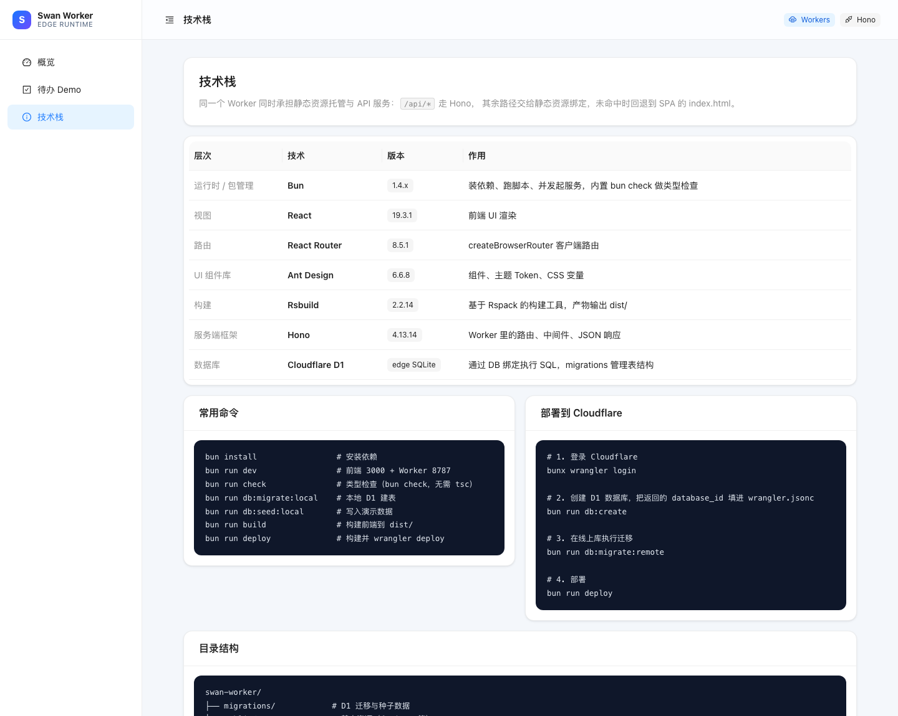

# Swan Worker

一个可直接上手的最小全栈模板：**React 19 + Ant Design 6 前端** 与 **Hono API + Cloudflare D1** 跑在同一个 Cloudflare Worker 上。

**线上演示**：https://swan-worker.312bdf.workers.dev

- 前端由 **Rsbuild** 打包，产物 `dist/` 直接作为 Workers 静态资源托管
- `/api/*` 由 Worker 内的 **Hono** 应用处理，数据落在 **D1**（边缘 SQLite）
- 全程用 **Bun** 安装依赖与执行脚本，不需要 Node.js
- 客户端路由用 **React Router 8**（`createBrowserRouter`）



## 技术栈

| 层次 | 技术 | 版本 |
| --- | --- | --- |
| 运行时 / 包管理 | Bun | 1.4.4 |
| 语言 | TypeScript（Bun 直接执行，无需 tsc） | 5.x 语法 |
| 类型检查 | Bun 内置 `bun check` | 1.4 |
| 视图 | React | 19.3 |
| 路由 | React Router | 8.5 |
| UI 组件库 | Ant Design + @ant-design/icons | 6.6 / 6.3 |
| 构建 | Rsbuild（Rspack） | 2.2 |
| 服务端框架 | Hono | 4.13 |
| 数据库 | Cloudflare D1 | 边缘 SQLite |
| 部署 | Wrangler | 4.154 |

## 快速开始

```bash
bun install
bun run db:migrate:local   # 初始化本地 D1（.wrangler/state）
bun run db:seed:local      # 可选：写入 5 条演示数据
bun run dev
```

`bun run dev` 用 Bun 1.4 原生的 `bun run --parallel` 并行启动两个进程（不需要 concurrently / npm-run-all）：

- **web**：Rsbuild dev server → http://localhost:3000（HMR）
- **api**：`wrangler dev` → http://127.0.0.1:8787（本地 workerd + 本地 D1）

输出会带 `dev:web |` / `dev:api |` 前缀，按行区分来源。

前端请求 `/api/*` 会被 dev server 代理到 8787，因此浏览器里只需要访问 3000 端口。

> 想直接看「生产形态」，用 `bun run preview`：先构建再把 `dist/` 交给 wrangler dev 托管，此时只开 8787 一个端口。
>
> ⚠️ 注意别写成 `bun build`。`bun build` 是 Bun 自带的打包器命令（需要传 entrypoint），不会执行 `package.json` 里的 `build` 脚本，会报 `Missing entrypoints`。脚本一律用 `bun run <script>`。

## 常用命令

```bash
bun run dev             # 前端 + Worker 同时开发
bun run dev:web         # 只启动前端
bun run dev:api         # 只启动 Worker
bun run build           # 构建前端到 dist/
bun run check           # 类型检查（bun check，约 80ms，无需安装 typescript）
bun run preview         # 构建 + 本地以生产形态运行
bun run deploy          # 构建 + wrangler deploy

bun run db:create         # 在 Cloudflare 上创建 D1 数据库
bun run db:migrate:local  # 本地执行 migrations/
bun run db:migrate:remote # 线上执行 migrations/
bun run db:seed:local     # 本地写入 seed/seed.sql
bun run db:seed:remote    # 线上写入 seed/seed.sql
```

## 目录结构

```
swan-worker/
├── migrations/            # D1 迁移（按文件名顺序执行）
│   ├── 0001_init.sql
│   └── 0002_index_optimize.sql
├── seed/                  # 演示数据，不属于迁移
│   └── seed.sql
├── public/                # 静态资源，构建时拷到 dist/
│   └── _headers           # 缓存策略与安全头
├── src/
│   ├── client/            # 前端
│   │   ├── api/client.ts  # /api 请求封装
│   │   ├── layouts/       # RootLayout（Sider + Header + Outlet）
│   │   ├── pages/         # HomePage / TodosPage / AboutPage / NotFound / Error
│   │   ├── router.tsx     # createBrowserRouter 路由表
│   │   ├── main.tsx       # 入口：ConfigProvider + antd App
│   │   ├── index.html     # HTML 模板
│   │   └── styles/        # 全局样式
│   ├── shared/types.ts    # 前后端共享类型
│   └── worker/            # Worker 端
│       ├── db/todos.ts    # 数据访问层（纯 SQL）
│       ├── routes/        # todos / stats 路由
│       ├── types.ts       # Env 绑定类型
│       └── index.ts       # Hono 应用 + 静态资源兜底
├── rsbuild.config.ts
├── wrangler.jsonc
└── tsconfig.json
```

## API

| 方法 | 路径 | 说明 |
| --- | --- | --- |
| GET | `/api/health` | 健康检查 |
| GET | `/api/stats` | 任务统计（总数 / 已完成 / 完成率） |
| GET | `/api/todos?status=all\|active\|completed&q=&limit=&offset=` | 列表 |
| POST | `/api/todos` | 新建，body `{ "title": "..." }` |
| PATCH | `/api/todos/:id` | 更新，body `{ "title"?, "completed"? }` |
| DELETE | `/api/todos/:id` | 删除单条 |
| DELETE | `/api/todos/completed` | 清空已完成 |

```bash
curl http://127.0.0.1:8787/api/todos
curl -X POST http://127.0.0.1:8787/api/todos \
  -H 'Content-Type: application/json' -d '{"title":"写点东西"}'
```

## 关键设计

**一个 Worker 同时干两件事。** `wrangler.jsonc` 里：

```jsonc
"assets": {
  "directory": "./dist",
  "binding": "ASSETS",
  "not_found_handling": "single-page-application",
  "run_worker_first": ["/api/*"]
}
```

- `run_worker_first: ["/api/*"]` —— API 请求先进 Worker，命中 Hono 路由
- 其余请求直接由静态资源返回，不消耗 Worker 调用
- `not_found_handling: single-page-application` —— 静态资源未命中时回退 `index.html`，React Router 的 `/todos`、`/about` 刷新不会 404
- Hono 的 `notFound` 里对 `/api/*` 返回 JSON 404，其它路径兜底到 `c.env.ASSETS.fetch()`

**D1 只出现在数据访问层。** `src/worker/db/todos.ts` 里全是 SQL 与行/对象映射，路由层只做参数校验和响应拼装，换 ORM 或加缓存时改动面很小。

**类型只写一次。** `src/shared/types.ts` 被前端和 Worker 同时引用，接口字段改名会立刻在两边报错。

**缓存与安全头写在 `public/_headers`。** 构建时它会被拷到 `dist/_headers`，Workers 静态资源读取后生效：`/static/*` 拿到 `max-age=31536000, immutable`（文件名带 hash，改内容必然改名），HTML 入口走 `no-cache`（否则发版后用户还在用旧壳），并统一加 `X-Content-Type-Options` 与 `Referrer-Policy`。

**错误不泄漏内部信息。** Worker 的 `onError` 只把堆栈写日志，响应里返回 `{ error, traceId }`（`traceId` 取 `cf-ray`，方便回查）；前端 `request()` 对非 JSON 响应做了兜底，边缘层直接吐 HTML 错误页时不会变成 `SyntaxError`。

**antd 6 的用法。** 通过 `<ConfigProvider locale={zhCN}>` + `<App>` 包裹，`message` / `modal` 从 `App.useApp()` 取，不再用静态方法。

**Bun 只负责装依赖和跑脚本，不执行 Worker 代码。** 前端构建走 Rsbuild（Rspack），Worker 由 `wrangler dev` 拉起本地 workerd 运行。`bun run --parallel` 是 Bun 1.4 才有的能力，所以 `engines.bun` 要求 `>=1.4.0`。

## 部署到 Cloudflare

```bash
# 1. 登录
bunx wrangler login

# 2. 创建 D1，把输出的 database_id 填进 wrangler.jsonc
bun run db:create

# 3. 在线上库建表
bun run db:migrate:remote

# 4. 部署
bun run deploy
```

`wrangler.jsonc` 里的 `database_id` 目前是占位 UUID，部署前必须替换。

## 界面

| 概览 | 待办 Demo | 技术栈 |
| --- | --- | --- |
|  |  |  |

## 备注

- 本地数据库文件在 `.wrangler/state/`，已加入 `.gitignore`；删掉目录重新 `db:migrate:local` 即可重置
- `seed/` 刻意与 `migrations/` 分开：迁移是结构变更，种子数据可以随时重跑
- 类型检查用 `bun run check`（Bun 1.4 内置，读同一份 `tsconfig.json`，输出与 tsc 一致）；项目不依赖 `typescript` 包，需要产出 `.d.ts` 时再 `bun add -d typescript`
- Bun 执行 `.ts` / `.tsx` 时只擦除类型、不做检查，能跑 ≠ 类型没问题，提交前记得 `bun run check`
- `tsconfig.json` 虽然不再给编译器用，但仍是必需的：`bun check` 靠它拿 `lib` / `types` / `paths`，编辑器靠它做类型提示；删掉它会立刻冒出「找不到 document」「找不到 @/shared/types」这类错误
- `@/*` 别名只写在 `tsconfig.json` 的 `paths` 里，Rspack 会自动读取（`resolve.tsConfig`），不需要在 `rsbuild.config.ts` 里重复声明
- `tsconfig.json` 里不要用 `baseUrl`（TS 7 已移除），`paths` 写相对路径：`"@/*": ["./src/*"]`
- 需要 SSR 时，可在 Rsbuild 开启 `server` 构建 + Hono 里渲染 HTML，但会放弃静态资源的零调用优势
